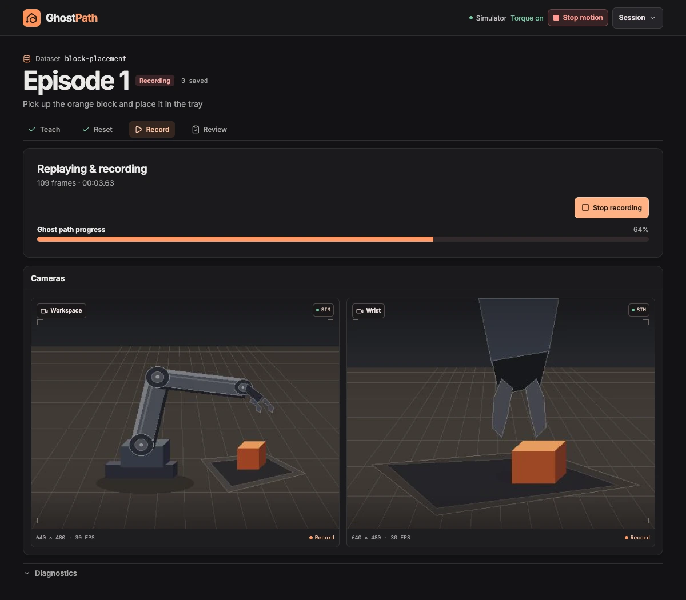
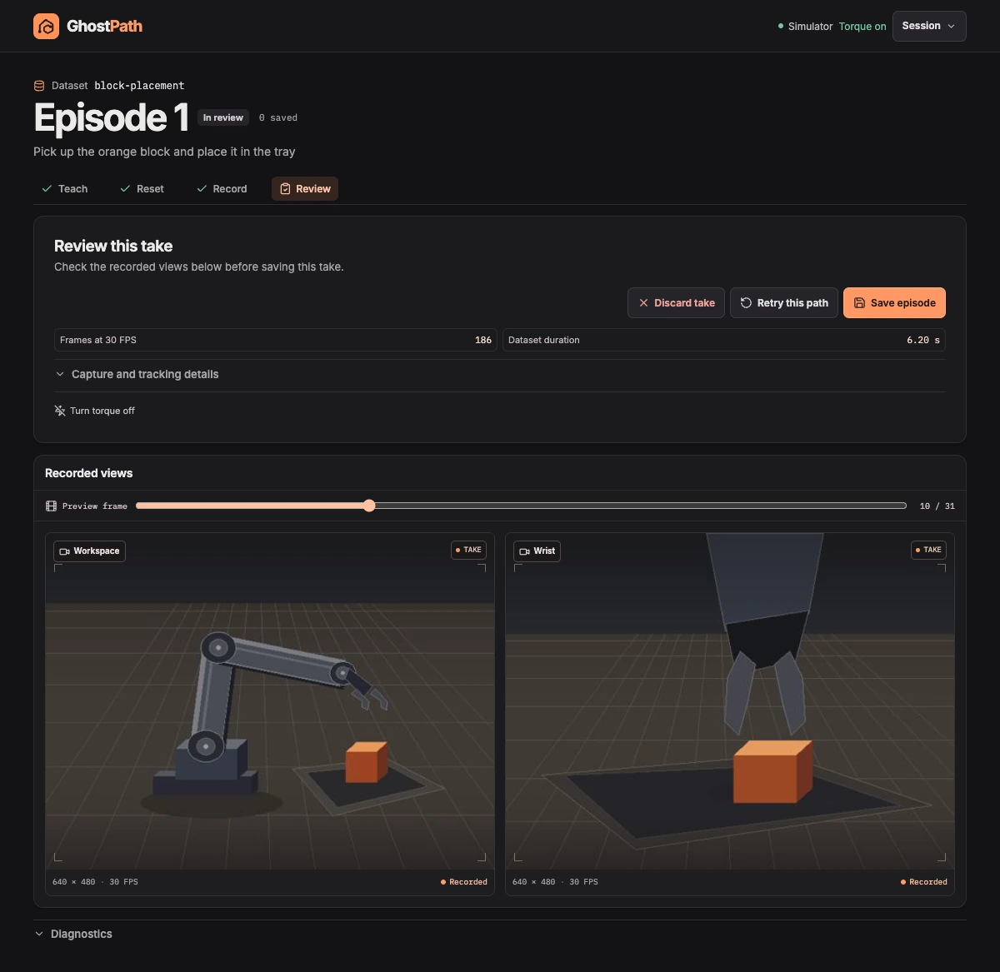
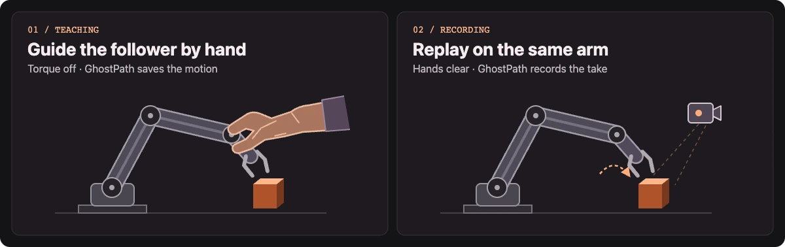

# GhostPath

**Show the arm what to do. Let it record the take.**

GhostPath makes it easy to collect clean robot demonstrations with just an **SO-101 follower**. There’s no leader arm to build or calibrate. Guide the follower by hand with its motors released (kinesthetic teaching), reset the scene, then step out of the way. GhostPath replays the taught motion and records the cameras, measured joint positions, and commands together. Your hand teaches the motion without getting in the way of the recorded views.

I’ve tried it on pick-and-place, cube stacking, and folding items. I’d start with pick-and-place. For something like folding, it’s simpler to reset the scene by hand.



## Try it without a robot

Install [uv](https://docs.astral.sh/uv/getting-started/installation/) and [Node.js](https://nodejs.org/) 22.12 or newer. Clone the repo and run:

```sh
git clone https://github.com/mattialoszach/ghostpath.git
cd ghostpath
./start.sh
```

Open [localhost:8765](http://127.0.0.1:8765/) in one browser tab. Choose **Connect simulator → Use current position → Example path**. Once teaching pauses, choose **Boomerang scene reset**, then **Replay & record**. Scrub the two recorded views, **Save episode**, and **Finish dataset**. You’ll get a real LeRobot dataset with simulated observations.



## Use your SO-101

```sh
./start.sh --hardware
```

1. Set up and calibrate the **follower** using the [LeRobot SO-101 guide](https://huggingface.co/docs/lerobot/so101). In GhostPath, select **SO-101**, scan for the serial port, and enter the same calibration ID.
2. Name the dataset, describe the task, and check your camera sources. Only cameras with **Record** enabled go into the dataset. You can also record joints without cameras.
3. Use the current position as a temporary start or choose a saved one. **Start teaching** and move the follower by hand. Hold it still when you **Stop teaching**. Reset the arm and objects by hand, or try **Boomerang scene reset** if the task can be reversed.
4. Clear the path and step out of the camera views. **Replay & record**, check the take, and save it if it looks right. You can reuse the path or teach a new one for the next episode.

**Before moving real hardware:** Try the simulator first. Support the arm and anything it’s holding before releasing torque. Stay with the arm during powered motion and keep a physical way to cut motor power. **Stop motion** or **Esc** is a software stop, not a substitute for cutting power.



## What gets saved

Datasets stay on your computer in `data/datasets/<name>` in [LeRobotDataset v3.0 format](https://huggingface.co/docs/lerobot/lerobot-dataset-v3). `observation.state` contains measured joint positions; `action` contains the commands actually sent. The raw hand-guided path is saved separately in `data/paths/` so you can reuse it without treating it as a commanded action.

To delete old parking poses or whole recording datasets, disconnect and open **Clean up saved data** on the setup screen. Deleting either leaves raw taught paths intact.

See the [recording guide](docs/recording.md) for camera setup, replay options, troubleshooting, and a Python example for opening a dataset. Pass `--data /path/to/workspace` or `--port 8765` to change the default storage location or server port.

## Development

```sh
uv sync --locked --extra hardware --extra dev
npm --prefix frontend ci
uv run --no-sync pytest -q
uv run --no-sync ruff check src tests
npm --prefix frontend run build
```

The Python backend lives in [`src/ghostpath`](src/ghostpath); the React workspace is in [`frontend`](frontend). For hot reload, run `uv run --no-sync ghostpath` and `npm --prefix frontend run dev` in separate terminals. Vite proxies the local API and WebSocket.

[MIT License](LICENSE)
